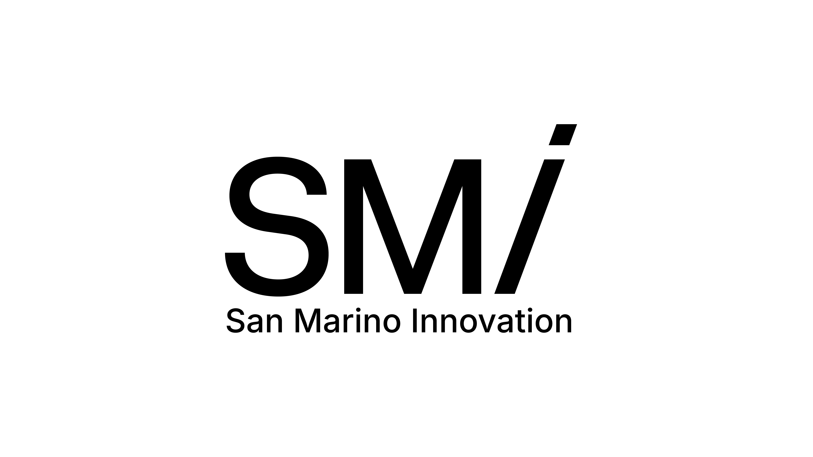

  <a href="https://www.sanmarinoinnovation.com">
    <picture>
      <source media="(prefers-color-scheme: dark)" srcset="brand/logo-smi-azzurro.png">
      
    </picture>
  </a>

<h1 align="center">San Marino Innovation</h1>

  <strong>Sito web istituzionale dell'Istituto per l'Innovazione della Repubblica di San Marino</strong> 
  <a href="https://www.sanmarinoinnovation.com">www.sanmarinoinnovation.com</a>

---

## L'Istituto

**San Marino Innovation S.p.A.** è l'Istituto per l'Innovazione della Repubblica di San Marino, società interamente partecipata dallo Stato.

L'Istituto valuta e attesta le **Imprese ad Alto Contenuto Tecnologico (IACT)** e accompagna imprenditori, founder e realtà innovative che scelgono la Repubblica di San Marino per avviare e far crescere un progetto ad alto contenuto tecnologico, all'interno di un ecosistema che riunisce startup, incubatori, partner, università e investitori.

## Il sito

Il sito istituzionale è la porta d'ingresso all'Istituto e al suo ecosistema. Consente di comprendere in pochi passaggi:

- **chi è l'Istituto**: missione, organi, Comitato Tecnico e team;
- **che cosa offre il regime IACT**: le fasce SUT I, SUT II e SAT, i requisiti di accesso e i benefici previsti dal Decreto Delegato n.159/2026;
- **come si presenta un'istanza** di attestazione;
- **chi fa già parte dell'ecosistema**, attraverso il Registro delle imprese attestate.

### Sezioni principali

| Sezione | Contenuti |
|---|---|
| [Chi siamo](https://www.sanmarinoinnovation.com/chi-siamo/) | L'Istituto, Consiglio di Amministrazione, Comitato Tecnico, team e contatti |
| [Startup](https://www.sanmarinoinnovation.com/startup/) | Come aprire un'impresa innovativa a San Marino e Registro delle imprese IACT attestate |
| [Ecosistema](https://www.sanmarinoinnovation.com/ecosistema/) | La visione, incubatori e Partner Certificati, partner dell'Istituto, progetti DLT |
| [Cosa facciamo](https://www.sanmarinoinnovation.com/cosa-facciamo/) | Bandi, eventi, fiere e competizioni, workshop e corsi |
| [Normativa](https://www.sanmarinoinnovation.com/normativa/) | Innovazione e regime IACT, tecnologie DLT, Sandbox Normativa |
| [News](https://www.sanmarinoinnovation.com/news/) | Notizie, media, rassegna stampa e pubblicazioni |
| [Trasparenza](https://www.sanmarinoinnovation.com/trasparenza/) | Documenti e informazioni pubblicati in qualità di società a partecipazione pubblica |

## Principi

- **Accessibilità** – il sito è progettato secondo le linee guida WCAG 2.2 livello AA: contrasti, navigazione da tastiera, testi alternativi e rispetto delle preferenze di movimento ridotto.
- **Riservatezza** – nessun sistema di tracciamento né servizio di terze parti è attivo senza il consenso del visitatore. I contenuti video vengono caricati solo su richiesta, in modalità a privacy avanzata.
- **Trasparenza** – il Registro pubblica esclusivamente i dati pubblici delle imprese attestate.
- **Prestazioni** – sito statico, leggero e veloce anche da dispositivi mobili.
- **Multilingua** – italiano come lingua principale; struttura predisposta per la versione inglese.

## Contatti

**San Marino Innovation S.p.A.**  
Strada Acquasalata, 4 – 47899 Serravalle, Repubblica di San Marino  
Telefono: [+39 0549 905413](tel:+390549905413)  
Email: [info@sanmarinoinnovation.com](mailto:info@sanmarinoinnovation.com)  
Orari: dal lunedì al giovedì 9:00–17:30, venerdì 9:00–16:30

[LinkedIn](https://www.linkedin.com/company/sanmarinoinnova/) · [YouTube](https://www.youtube.com/channel/UCpNEKsEtHk5rUgh9kxCnRvg) · [Facebook](https://www.facebook.com/sanmarinoinnova/) · [Instagram](https://instagram.com/sanmarinoinnova)

---

## About (English)

**San Marino Innovation S.p.A.** is the Institute for Innovation of the Republic of San Marino, a company wholly owned by the State. The Institute assesses and grants the attestation of **High-Tech Companies (IACT)** and supports entrepreneurs and founders who choose San Marino to start and grow an innovative project. The English version of the website is in preparation.

---

## Informazioni su questo repository

Questo repository contiene la **versione pubblicata** del sito, generata automaticamente e distribuita tramite GitHub Pages. I file presenti sono il risultato della compilazione e non vanno modificati direttamente: lo sviluppo, i contenuti e la redazione sono curati dal team di San Marino Innovation in un archivio separato.

Per segnalazioni su contenuti, accessibilità o errori del sito è possibile scrivere a [info@sanmarinoinnovation.com](mailto:info@sanmarinoinnovation.com).

© San Marino Innovation S.p.A. – Tutti i diritti riservati. Testi, immagini, marchi e loghi presenti nel sito sono di proprietà di San Marino Innovation S.p.A. o dei rispettivi titolari.

